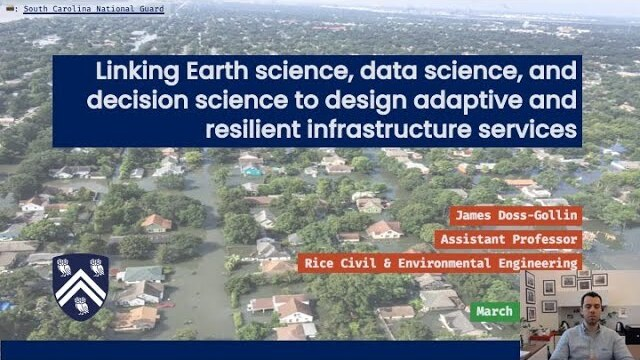

::: {.home-page}

<h1 class="visually-hidden">Doss-Gollin Research Group</h1>

::: {.home-hero}

::: {.grid .align-items-center}

::: {.g-col-12 .g-col-md-5 .home-hero-video}
```{=html}
<a class="home-video" href="https://www.youtube.com/watch?v=gI2I8Cq-14g">
  
  <span class="home-video-caption">Watch an overview of the group on YouTube</span>
</a>
```
:::

::: {.g-col-12 .g-col-md-7 .home-hero-text}
The **Doss-Gollin Research Group** at [Rice University's Department of Civil and Environmental Engineering](https://ceve.rice.edu) studies how flood risk in cities is changing, and how to plan infrastructure that holds up as it does.
We build probabilistic hazard models and decision-support tools, integrating Earth science, AI, and decision analysis to characterize changing hazards, quantify their impacts on the built environment, and design adaptive risk-management strategies.
We co-develop these tools with structural engineers, water managers, industry, and community organizations.

Prospective students and postdocs: see [how to join the group](joinus/index.qmd).
:::

:::

:::

::: {.grid}

::: {.g-col-12 .g-col-lg-6 .home-news-col}

::: {.section-header-with-link}
## News

[all news →](news.qmd){.see-all-link}
:::

::: {#news-listings}
:::

:::

::: {.g-col-lg-1}
:::

::: {.g-col-12 .g-col-lg-5 .home-papers-col}

::: {.section-header-with-link}
## Featured Papers

[all publications →](publications.qmd){.see-all-link}
:::

::: {#featured-papers}
:::

:::

:::

:::
